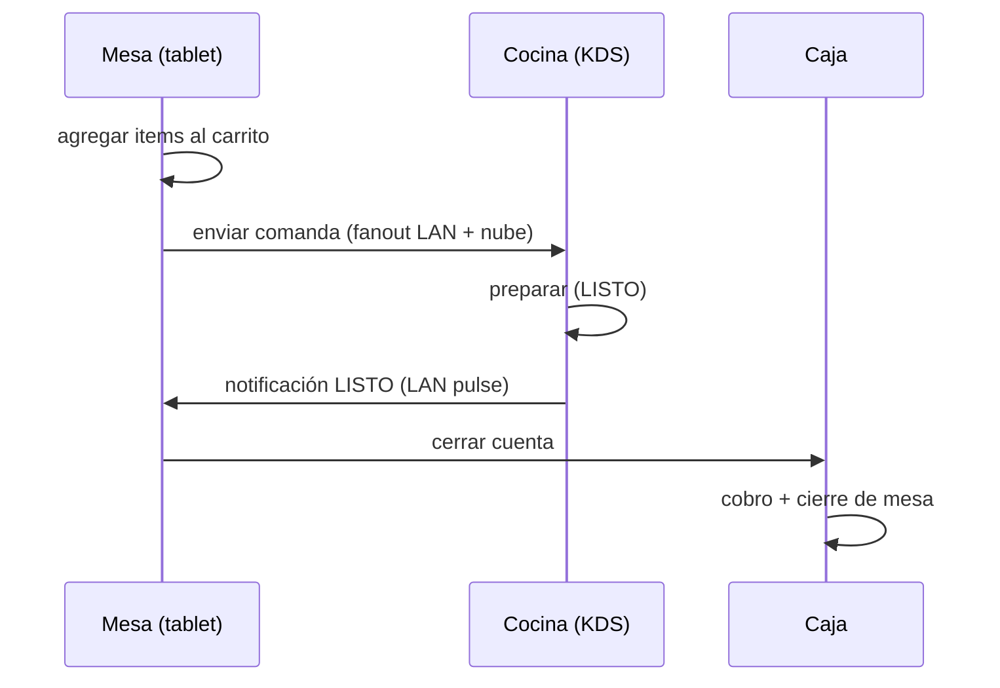
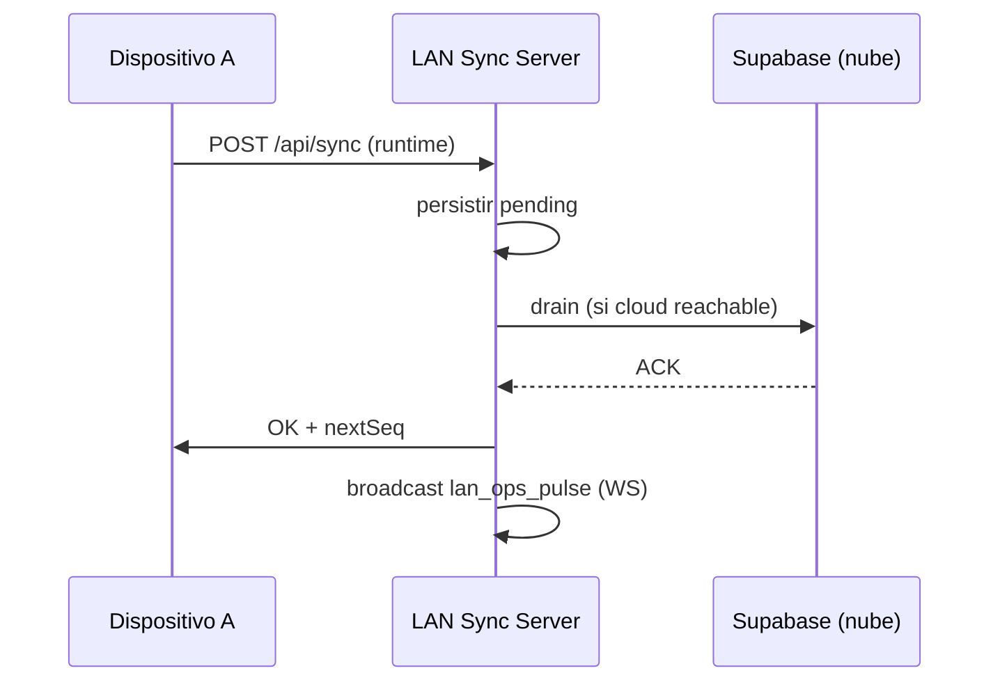
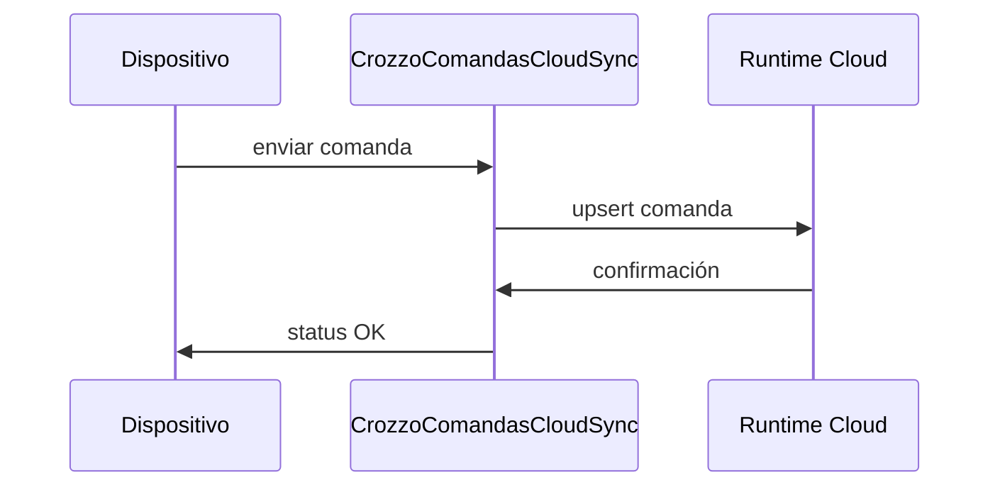
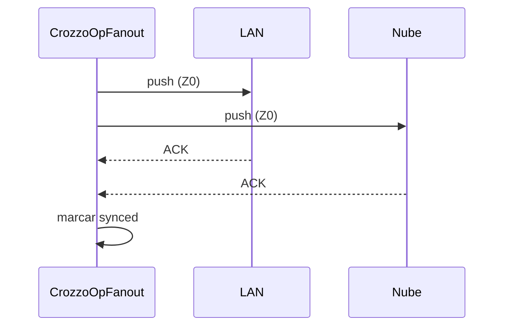

# Secuencias críticas — Crozzo POS (auto-generado / manual)

> Secuencias de flujos críticos. Auto-generar desde `trace_path` del grafo cuando esté disponible. Actualizar manualmente hasta entonces.

## 1. Venta mesa → cocina → cobro

## 2. Sync runtime (nube ↔ LAN)

## 3. Comanda cloud sync

## 4. Fanout híbrido (Z0)

## Notas
- Generar automáticamente con `npm run graph:search -- --name_pattern ".*"` + trace_path cuando codebase-memory esté indexado para todo el stack.
- Actualizar manualmente si cambia un flujo crítico.
- Referenciado por `docs/maps/INDEX.md`.
